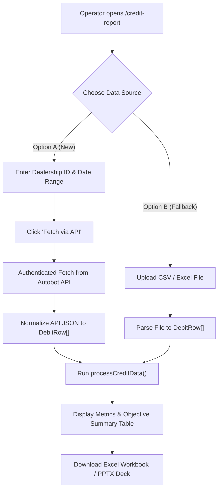

# PRD: Direct Dealership Billing API Integration for Credit Refund Report

**Document Status**: Proposed / Draft v1  
**Target Systems**: `autobot_agents` (API Provider) & `Mastersheetupdater` (`app/credit-report`)  
**Target Feature**: Direct API Fetch for Credit Usage & Objective Report Generation  

---

## 1. Executive Summary & Problem Statement

### 1.1 Context
Currently, generating dealership credit usage and refund reports in `Mastersheetupdater` requires an operator to log into Autobot Webapp, navigate to the Billing & Ledger section, select a date range, download a CSV export, and manually upload that file into the Credit Report tool (`/credit-report`).

### 1.2 Problems Identified
1. **Operational Inefficiency**: The manual export-and-upload workflow is slow, error-prone, and prevents automated scheduling or real-time auditing.
2. **Discrepant & Inflated Credit Totals**: When checking into dealerships, exported or displayed credits were observed to be significantly higher than expected. Root causes identified in `autobot_agents`:
   - **Timestamp Leakage**: Filtering on `updated` rather than `created` timestamps pulls in old historical debits whenever background jobs re-touch records.
   - **Transaction Type Contamination**: Default queries omitting strict `transaction_type=debit` clauses can capture credit recharges and refunds, distorting debit sums.
   - **Voice Duration Multiplier**: In `call_completed`, quantity represents raw duration in seconds billed at `0.133 credits/sec`, which can appear anomalous without duration unit normalization.
3. **Data Freshness Lag**: Manual downloads create static snapshots that quickly fall out of sync with ongoing campaign executions.

---

## 2. Product Objectives & Success Metrics

### 2.1 Objectives
* **Direct Ingestion**: Allow operators to input Dealership ID, Date Range, and Channel filter in `Mastersheetupdater` and directly stream billing ledger data via API.
* **Backward Compatibility**: Retain CSV/Excel drag-and-drop file upload as a fallback.
* **Reconciliation & Inflation Prevention**: Enforce strict query parameters (`transaction_type=debit`, `created` timestamp bounds) to eliminate credit inflation.
* **Full Pipeline Parity**: Convert API items directly into `DebitRow[]` structures compatible with existing `processCreditData()`, Excel workbook generators, and PowerPoint slide deck renderers.

### 2.2 Success Metrics
* Time-to-report generation reduced from ~3 minutes to under 5 seconds.
* 0% variance between API-fetched debit sums and verified database ledger debits for the identical time window.
* Zero formula errors in generated Excel workbooks and presentation decks.

---

## 3. User Flows & Experience (UI/UX)



### 3.1 UI Controls on `/credit-report`
1. **Mode Switcher**: Tabs or segmented switch: `[Direct API Ingestion]` | `[File Upload (Legacy)]`.
2. **Input Fields**:
   - **Dealership ID** (Text input or dropdown with autocompletion / recent history).
   - **Date Range Picker** (Presets: Today, Yesterday, This Week, Last Week, Month-to-Date, Custom Start/End).
   - **Channel Filter** (Dropdown: All Channels, WhatsApp Only, Voice Only).
   - **Environment Selector** (Dev / Staging / Production).
3. **Action Button**: "Fetch & Analyze" with active spinner and pagination progress counter (`Fetching page X (Y records)...`).
4. **Validation Banners**:
   - Highlight potential unmapped objectives or abnormally high call duration records.
   - Summary parity pill comparing total debits vs total events.

---

## 4. API Specification & Data Architecture

### 4.1 Endpoint Contract
* **URL**: `GET {API_BASE_URL}/gryd/db/objects/billing`
* **Default Base URLs**:
  - Development: `https://autobot-webapp-dev.gryd.in`
  - Production: Configured via environment variable (`NEXT_PUBLIC_AUTOBOT_API_URL`).

### 4.2 Authentication Headers
```http
Content-Type: application/json
Accept: application/json
X-GRYD-ENTERPRISE-ID: autocrm
X-GRYD-APPLICATION-ID: autocrm
X-GRYD-ROLE: agent
X-GRYD-TOKEN: <GRYD_TOKEN>
X-GRYD-SESSION-ID: <GRYD_SESSION_ID>
```

### 4.3 Query Parameters
| Parameter | Type | Required | Value / Behavior | Justification |
|---|---|---|---|---|
| `dealership_id` | `string` | **Yes** | E.g. `"anant_cars"` | Scope records strictly to tenant |
| `transaction_type` | `string` | **Yes** | `"debit"` | **Prevents credit inflation** by excluding recharges |
| `sort_by` | `string` | **Yes** | `"created"` | Uses immutable creation time (avoids `updated` drift) |
| `sort_reverse` | `string` | **Yes** | `"true"` | Newest records first |
| `page_number` | `number` | **Yes** | `1, 2, ...` | Batch pagination |
| `page_size` | `number` | **Yes** | `100` | Optimal throughput per HTTP turn |
| `created` | `string` | Optional | `"{startSec},{endSec}"` | Epoch seconds range filter |
| `channel` | `string` | Optional | `"whatsapp_chat"` / `"voice_phone"` | Channel isolation |

### 4.4 Pagination Architecture
The client or proxy executes a sequential/batched retrieval loop:
1. Call initial page (`page_number=1`, `page_size=100`).
2. Read `total` or `total_number` from response JSON.
3. If `total > items.length`, iterate `page_number++` until accumulated records reach `total` or an empty batch is returned.
4. Graceful retry with exponential backoff (max 3 retries per batch).

---

## 5. Data Normalization & Mapping Rules

The raw API objects from Autobot must be transformed directly into the `DebitRow` interface consumed by `credit-utils.ts`:

### 5.1 Field Mapping Matrix
| Target Field (`DebitRow`) | Source API Field (`billing`) | Transformation / Fallback Rule |
|---|---|---|
| `billingId` | `item.billing_id` | If missing, fallback to generated index ID |
| `dateTimeRaw` | `item.transaction_date` | If missing, format `item.created` epoch to ISO/IST string |
| `dateObj` | `item.created` or `item.transaction_date` | Parsed Javascript `Date` instance |
| `transactionType` | `item.transaction_type` | Must equal `"debit"` |
| `itemName` | `item.item_name` | `"call_connected"`, `"call_completed"`, `"message_delivered"`, `"response_to_query"` |
| `channel` | `item.channel` | Mapped to `"voice_phone"` or `"whatsapp_chat"` |
| `description` | `item.item_description` | Raw string parsed by `parseDescription()` grammar |
| `quantity` | `item.item_quantity` | Numeric float (counts or call duration seconds) |
| `creditsSpent` | `item.item_total` | Float total credits debited |
| `status` | `item.status` | Defaults to `"success"` |

---

## 6. Discrepancy Prevention & Audit Rules

1. **Strict Debit Filtering**: Never query without `transaction_type=debit`. Summing unconditioned records adds top-up payments into spent credits.
2. **Immutable Timestamp Anchor**: Query range MUST use `created` field bounds. The `updated` field is mutated on record updates, leading to retrospective inclusion of older transactions.
3. **Call Duration Unit Sanity**: `call_completed` quantity is duration in seconds. Verify credit formula: $\text{credits} = \text{seconds} \times 0.133$. Flag any call with duration $> 1800\text{s}$ (30 mins) for manual review.

---

## 7. Implementation Plan & Milestones

* **Phase 1: API Proxy & Client Layer**: Next.js API route `/api/autobot/billing` in `Mastersheetupdater` + paginated client fetcher.
* **Phase 2: UI Integration**: Dealership ID input, date preset picker, and "Fetch via API" button in `app/credit-report/page.tsx`.
* **Phase 3: Validation & Error Handling**: Graceful error handling for expired auth tokens (400/401) and credit variance checks.
* **Phase 4: Verification & Acceptance**: Zero-regression verification with existing Excel/PPTX generators against legacy CSV test fixtures.

---

## 8. Open Questions & Technical Considerations

1. **Authentication Mode**: Service-level token configured in `.env.local` vs operator-provided session token in UI?
2. **Dealership List Autocomplete**: Query `/gryd/db/objects/dealership` for a dropdown or retain text input?
3. **Default Range**: Default to `this_week` matching Autobot, or require explicit user selection?

